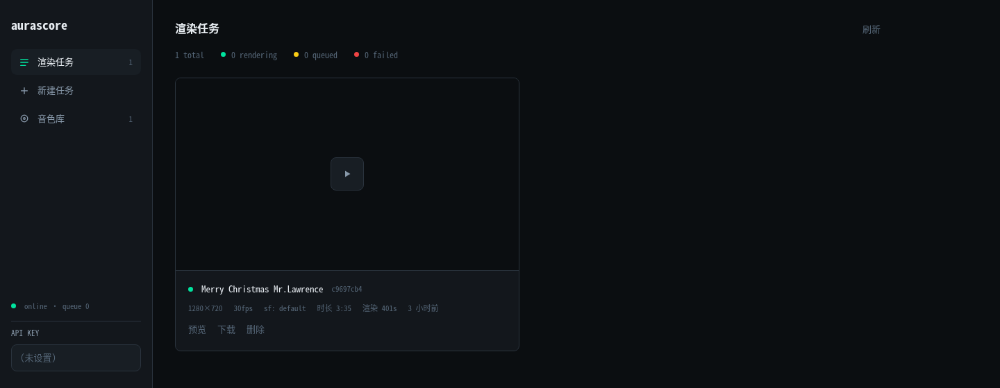
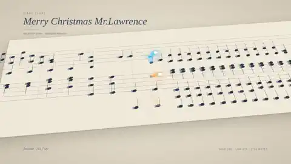

# Aurascore — 动态乐谱

根据 MIDI 文件渲染成动画乐谱

## 效果预览

工作台



渲染效果（示例曲目 *Merry Christmas Mr. Lawrence*）：



## 功能

- 上传 MIDI + 配置（曲名/帧率/分辨率/音色），异步渲染 mp4
- Web 管理界面：任务列表、实时进度、在线预览与下载
- SoundFont 音色库管理（`/api/v1/soundfonts`）
- Docker 一键部署，数据持久化在 `./data`

## 快速开始（Docker，推荐）

```bash
docker run -p 9302:9302 -v ./data:/app/data ghcr.io/zunley/aurascore:latest
```

浏览器打开 `http://<host>:9302/` 即可使用。

## 环境变量

| 变量 | 默认 | 说明 |
|------|------|------|
| `PORT` | 9302 | 监听端口 |
| `API_KEY` | 关闭 | 设置后启用 `X-API-Key` 鉴权 |
| `DATA_DIR` | ./data | 应用数据目录 |
| `WORKER_CONCURRENCY` | 1 | 并行渲染数 |
| `MAX_QUEUE_DEPTH` | 20 | 最大队列数 |

## 文档

- [API 文档](docs/API.md)
- [设计方案](docs/render-service-plan.md)

## 许可注意

Remotion 对个人及 ≤3 人团队免费；更大规模商用需购买 [company license](https://remotion.dev/license)。
