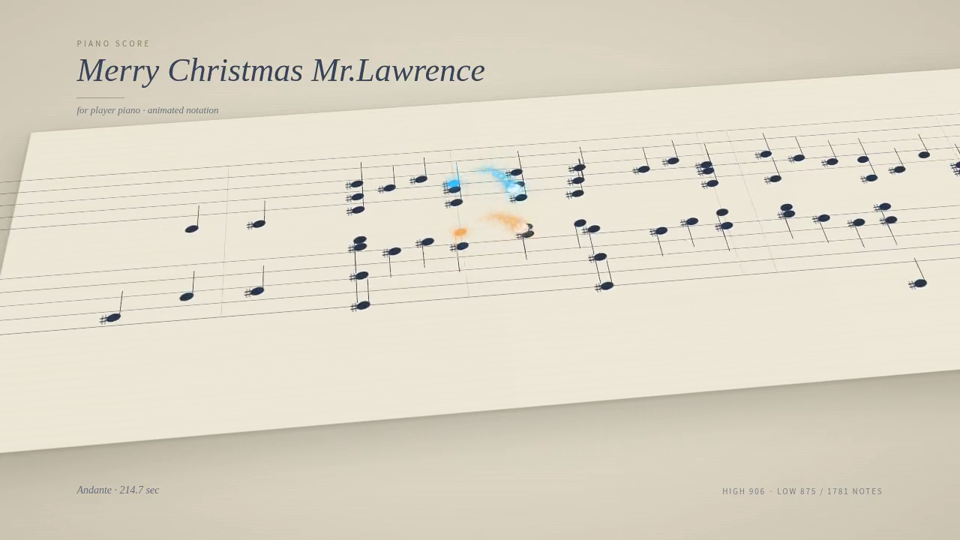
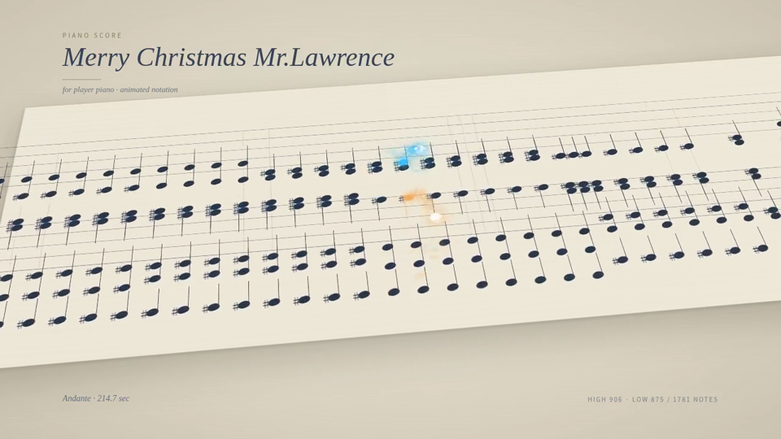

# aurascore — MIDI 动态乐谱视频渲染服务

把 MIDI 文件渲染成动画乐谱视频（[Remotion](https://remotion.dev) 合成 + Fastify 服务）。上传 `.mid` 与元信息，服务端异步渲染后返回 mp4，自带 Web 管理控制台。

## 效果预览

Web 管理控制台 —— 任务列表、渲染进度、在线预览与下载：


渲染效果片段（点击封面观看，示例曲目 *Merry Christmas Mr. Lawrence*，源文件在 [docs/assets](docs/assets)）：

[](docs/assets/demo-melody.mp4)
[](docs/assets/demo-climax.mp4)

## 功能

- 上传 MIDI + 配置（曲名/帧率/分辨率/音色），异步渲染 mp4
- Web 管理界面：任务列表、实时进度、在线预览与下载
- SoundFont 音色库管理（`/api/v1/soundfonts`）
- Docker 一键部署，数据持久化在 `./data`

## 快速开始（Docker，推荐）

```bash
git clone https://github.com/zunley/aurascore.git
cd aurascore
cp .env.example .env    # 按需设置 API_KEY / PORT
make up                 # 构建镜像并后台启动
```

浏览器打开 `http://<host>:9302/` 即可使用。详细接口见 [docs/API.md](docs/API.md)。

### 使用预构建镜像

推送 `v*` tag 时自动构建并发布到 GHCR：

```bash
docker run -p 9302:9302 -v ./data:/app/data ghcr.io/zunley/aurascore:latest
```

## 本地开发

前置：Node.js ≥ 20.19、`fluidsynth`、`ffmpeg`。

```bash
npm i
npm run dev:setup   # 准备 data/jobs/dev/ 与 data/soundfonts/
npm run server      # 终端 1：API + 渲染 worker（:9302）
npm run dev         # 终端 2：Remotion Studio 预览
```

## 环境变量

| 变量 | 默认 | 说明 |
|------|------|------|
| `PORT` | 9302 | 监听端口 |
| `API_KEY` | 关闭 | 设置后启用 `X-API-Key` 鉴权 |
| `DATA_DIR` | ./data | 任务与 SoundFont 存储目录 |
| `WORKER_CONCURRENCY` | 1 | 并行渲染数（每个约占 1-2GB 内存） |
| `MAX_QUEUE_DEPTH` | 20 | 队列满时提交返回 429 |

## 文档

- [API 文档](docs/API.md)
- [设计方案](docs/render-service-plan.md)

## 许可注意

Remotion 对个人及 ≤3 人团队免费；更大规模商用需购买 [company license](https://remotion.dev/license)。
